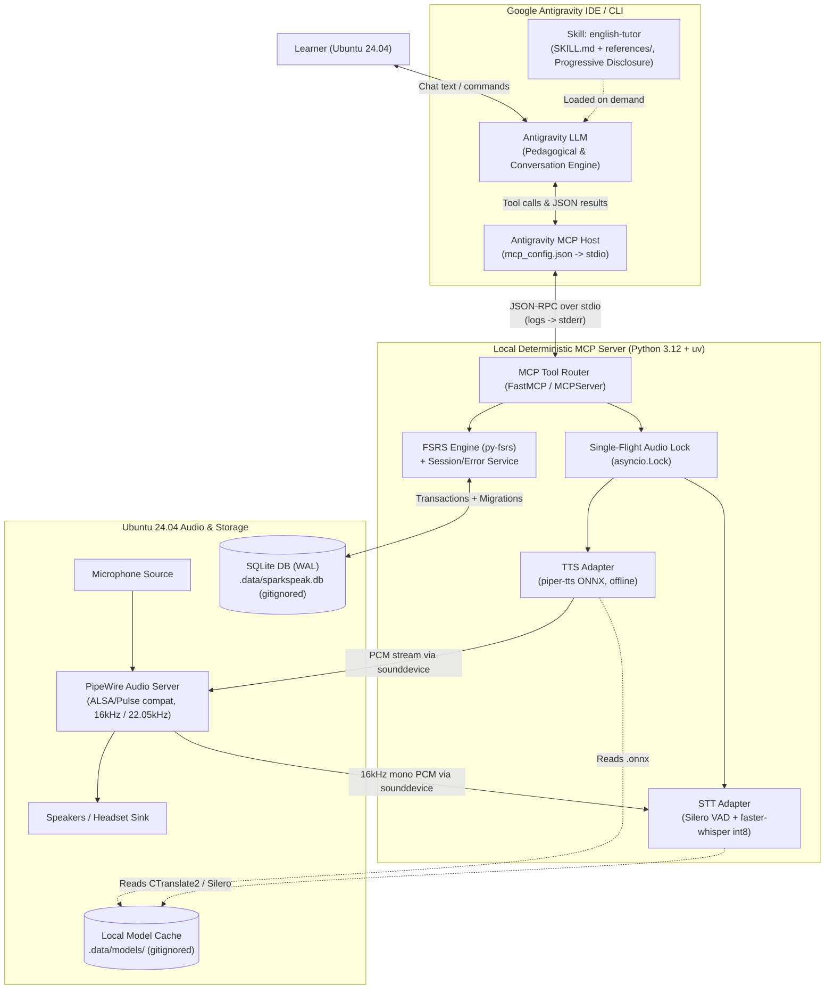
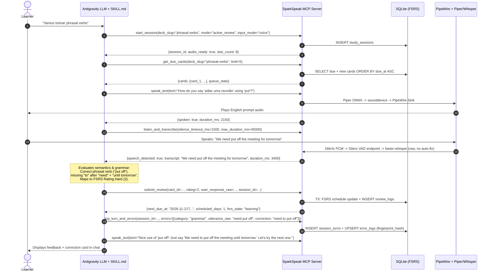
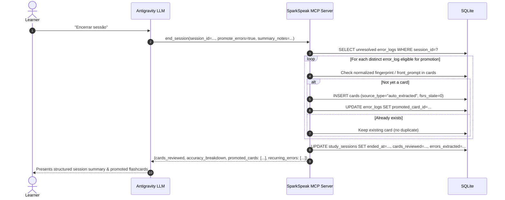

# English Tutor Harness Design

**Spec**: `.specs/features/01-english-tutor-harness/spec.md`
**Status**: Approved
**Approved**: 2026-11-20 - user: "aceito tudo o que foi recomendado. . automática com resumo e voz do tutor com piper-tts. A stack e está aprovada"

---

## 1. Architecture Overview & Antigravity Lifecycle Integration

SparkSpeak separates **pedagogical reasoning** (handled by the Antigravity LLM at zero incremental API cost) from **deterministic state, SRS math, and local audio I/O** (handled by a local Python MCP server over `stdio`).

### 1.1 Integration with the Google Antigravity Lifecycle

1. **Progressive Disclosure via Agent Skill (`english-tutor`)**:
   - Antigravity injects only the skill's `name` and `description` (~40 tokens) into normal coding sessions.
   - Full pedagogical instructions (`SKILL.md`) load on demand **only** when the user initiates an English study session (e.g., *"vamos estudar inglês"*, *"start English roleplay"*).
   - Supporting rubrics (`pedagogy-modes.md`, `personas.md`, `error-taxonomy.md`) live in `references/` and are read selectively only when needed.
2. **Plugin Packaging (`.agents/plugins/sparkspeak/`)**:
   - Following Antigravity's native plugin discovery (`.agents/plugins/<name>/`), bundling `plugin.json`, `mcp_config.json`, and `skills/english-tutor/SKILL.md` keeps the MCP server and skill scoped cleanly to the `sparkspeak` workspace (and easily toggled via `agy plugin enable/disable` or `config.json`).
   - Alternative: registering `.agents/skills/english-tutor/SKILL.md` in workspace + `sparkspeak` in `~/.gemini/config/mcp_config.json` if global cross-workspace availability is desired.
3. **Stdio MCP Transport & Stream Hygiene**:
   - Antigravity's Language Server spawns `uv run --directory <repo> sparkspeak-mcp` as a child process communicating via JSON-RPC over `stdin`/`stdout`.
   - **Critical Invariant**: `stdout` is strictly reserved for JSON-RPC frames; all Python/library logs (including `faster-whisper`, `onnxruntime`, `sounddevice`) MUST write exclusively to `stderr` or file logs.
4. **Why No Mandatory `Stop` / `PreInvocation` Hook for Core Loop**:
   - Antigravity `hooks.json` executes synchronously on *every* agent turn in the workspace when enabled. Running audio/DB scripts inside `PreInvocation` or `Stop` hooks would add latency to non-tutoring tasks (e.g., editing code). Therefore, session lifecycle (`start_session`, `end_session`) is governed cleanly by the on-demand `SKILL.md` protocol + SQLite durability.

### 1.2 Architecture Diagram (Containers & Data Flow)



### 1.3 Sequence Diagram: Voice Active Review & Fallback Turn



### 1.4 Sequence Diagram: Post-Session Review & Error Promotion



### 1.5 Proposed Architecture Decision Records (ADRs)

Upon user approval of this spec/design, the following ADRs will be materialized in `docs/adr/` and indexed in `.specs/STATE.md`:

| Proposed ADR | Title | Decision Summary |
| --- | --- | --- |
| `AD-001` | Python 3.12 + `uv` + Official `mcp` SDK for Local MCP | Chosen over Java 25 / Spring AI MCP for sub-250ms stdio startup and native PipeWire/ML bindings |
| `AD-002` | FSRS (`py-fsrs`) over Legacy SM-2 | Chosen for DSR memory modeling, no ease-hell trap, and future weight optimization |
| `AD-003` | Repo-Local Gitignored SQLite + Versioned Migrations | Mutable DB at `.data/sparkspeak.db` (`.gitignore`); SQL migrations and seed decks in Git |
| `AD-004` | Dedicated `piper-tts` + `faster-whisper`/Silero VAD Audio Pipeline | Offline-first PipeWire I/O preserving raw learner speech errors without auto-correction |
| `AD-005` | Antigravity Workspace Plugin Packaging | Bundles `SKILL.md` + `mcp_config.json` in `.agents/plugins/sparkspeak/` for workspace isolation |

---

## 2. Tech Stack Comparison & Directory Structure

### 2.1 Local MCP Server Stack: Python 3.12+ (`uv` + `mcp` SDK) vs. Java 25 (Spring AI MCP)

| Evaluation Criterion | Python 3.12+ (`uv` + Official `mcp` SDK) | Java 25 (Spring AI MCP) | Verdict |
| --- | --- | --- | --- |
| **Stdio Cold Startup Latency** | ~100–250 ms (`uv` cached venv); single-process warm session after spawn | 2–5 s on standard JVM (`java -jar`); <300 ms only with GraalVM Native Image (`nativeCompile`) | **Python** wins without AOT build friction |
| **Memory Footprint (Idle / Active)** | ~35 MB base + lazy-loaded Whisper `base`/`small` int8 (~300–500 MB) + Piper (~80 MB) | ~250–450 MB JVM heap *before* native ML/audio buffers | **Python** wins |
| **Linux PipeWire / ALSA Audio I/O** | Direct `sounddevice` (PortAudio -> PipeWire/ALSA) + `numpy` PCM arrays in 10 lines | `javax.sound.sampled` struggles with PipeWire virtual devices; requires JNI/Panama (`FFM`) or shelling out to `pw-record`/`pw-play` | **Python** wins decisively |
| **Local STT (`faster-whisper`) & VAD** | First-class native Python wheels (`faster-whisper`, CTranslate2, built-in Silero VAD) | No first-class Spring AI local Whisper+VAD; requires `whisper.cpp` JNI wrapper or subprocess IPC | **Python** wins decisively |
| **Local TTS (`piper-tts`)** | Official `piper-tts` Python package (`PiperVoice` ONNX in-memory streaming) | Requires shelling out to `piper` CLI binary per utterance | **Python** wins |
| **SRS Algorithm (`py-fsrs`)** | Official `fsrs` package maintained by Open Spaced Repetition | Must port FSRS-5 math manually or maintain custom SM-2 | **Python** wins |
| **Code Quality & Static Analysis** | `ruff` (lint + format), `mypy` / `pyright`, `pytest`, compatible with `.agents/scripts/quality-check.sh` & SonarQube | Maven Checkstyle/Spotless, JUnit 5, SonarQube | Tie (both well supported by repo harness) |

**Decision**: **Python 3.12+ managed by `uv`** using the official `mcp` Python SDK (`MCPServer` / FastMCP pattern), `fsrs`, `faster-whisper`, `piper-tts`, `sounddevice`, and `sqlite3` (stdlib).

### 2.2 TTS Engine Evaluation (`tts-mcp` vs Dedicated `piper-tts` vs `kokoro` vs `edge-tts`)

| Option | Pros | Cons | Decision |
| --- | --- | --- | --- |
| **External `tts-mcp` (`kokoro-tts-mcp` / `edge_tts_mcp_server`)** | Zero custom TTS code; Kokoro-82M has near-audiobook quality | Splits audio lock across two separate MCP servers (`srs-mcp` + `tts-mcp`), risking mic/speaker race conditions on PipeWire; `kokoro` uses ~600MB+ RAM and heavier CPU; `edge-tts` fails offline | Rejected as primary; keep `TTSEngine` interface pluggable |
| **Dedicated `piper-tts` inside SparkSpeak MCP** | 100% offline; ~80MB RAM; fast CPU synthesis (<200ms); shares `asyncio.Lock` with `listen_and_transcribe` so TTS never leaks into mic | Slightly more robotic than Kokoro-82M (still clear and natural with `en_US-lessac-medium` or `en_US-amy-medium`) | **Chosen default** |
| **`edge-tts` (Cloud fallback)** | Wide accent variety (`en-US`, `en-GB`, `en-AU`) with 0 local weights | Requires internet + undocumented Microsoft Edge WebSocket endpoint | Optional future adapter behind `TTSEngine` protocol |

### 2.3 Exact Directory Structure

```text
sparkspeak/
├── AGENTS.md
├── pyproject.toml                       # uv project, ruff, pytest, mypy config, console scripts
├── uv.lock
├── sonar-project.properties
├── .agents/
│   ├── plugins/
│   │   └── sparkspeak/
│   │       ├── plugin.json              # Antigravity workspace plugin manifest
│   │       ├── mcp_config.json          # Stdio MCP registration (`uv run sparkspeak-mcp`)
│   │       └── skills/
│   │           └── english-tutor/
│   │               ├── SKILL.md         # Concise on-demand pedagogical orchestrator
│   │               └── references/
│   │                   ├── pedagogy-modes.md   # Active Review vs Roleplay rules & FSRS rating rubric
│   │                   ├── personas.md         # Deck personas (Tech Lead, Interviewer, Everyday)
│   │                   └── error-taxonomy.md   # Error categorization & card extraction criteria
│   ├── rules/                           # Existing repo harness rules
│   └── scripts/                         # Existing validate/quality scripts
├── src/
│   └── sparkspeak/
│       ├── __init__.py
│       ├── config.py                    # Repo .data/ paths (sparkspeak.db, models), env overrides
│       ├── domain/
│       │   ├── models.py                # Dataclasses/Pydantic DTOs (Deck, Card, ReviewResult, ErrorLog)
│       │   ├── errors.py                # Structured recoverable error codes
│       │   └── srs_engine.py            # Deterministic FSRS wrapper (pure domain logic)
│       ├── application/
│       │   ├── session_service.py       # start_session, end_session, error promotion orchestration
│       │   ├── review_service.py        # get_due_cards, submit_review (idempotent), add_card (dedup)
│       │   └── audio_service.py         # Single-flight asyncio.Lock coordinating TTS & STT
│       ├── infrastructure/
│       │   ├── db/
│       │   │   ├── connection.py        # SQLite WAL + foreign_keys + busy_timeout
│       │   │   ├── migrator.py          # Sequential SQL migration runner
│       │   │   ├── repositories.py      # SQL queries & transaction boundaries
│       │   │   ├── migrations/
│       │   │   │   └── 001_initial.sql  # Complete DDL
│       │   │   └── seeds/
│       │   │       └── 001_default_decks.sql  # Conversational, Phrasal Verbs, Tech Meetings
│       │   └── audio/
│       │       ├── ports.py             # TTSEngine & STTEngine Protocols
│       │       ├── pipewire_device.py   # sounddevice input/output probing & PCM playback/capture
│       │       ├── piper_tts.py         # Offline Piper ONNX implementation
│       │       └── whisper_stt.py       # Silero VAD endpointing + faster-whisper raw transcription
│       ├── mcp/
│       │   └── server.py                # MCPServer stdio entrypoint + tool schemas + stderr logging
│       └── cli/
│           └── setup_models.py          # `sparkspeak-setup-models` & `sparkspeak-health` helpers
├── tests/
│   ├── unit/
│   │   ├── test_srs_engine.py
│   │   ├── test_error_dedup.py
│   │   └── test_tool_validation.py
│   ├── integration/
│   │   ├── test_sqlite_migrations_and_reviews.py
│   │   ├── test_whisper_wav_fixture.py  # Verifies raw error preservation on WAV audio
│   │   └── test_mcp_stdio_protocol.py   # Real stdio JSON-RPC roundtrip
│   └── fixtures/
│       └── audio/                       # Small WAV clips with intentional grammar errors
└── docs/                                # Synced project architecture docs & ADRs

# Mutable local user data inside repo (ignored via .gitignore):
.data/
├── sparkspeak.db                        # Live SQLite database (WAL mode)
├── backups/                             # Auto-backup before schema migrations
└── models/
    ├── piper/
    │   ├── en_US-lessac-medium.onnx
    │   └── en_US-lessac-medium.onnx.json
    └── whisper/                         # faster-whisper CTranslate2 cache
```

---

## 3. SQLite Data Model & SRS Algorithm Justification

### 3.1 Algorithm Decision: FSRS vs. SM-2

| Aspect | SM-2 (Legacy Anki) | FSRS (`py-fsrs`, DSR Model) |
| --- | --- | --- |
| **Memory State** | `ease_factor`, `interval`, `repetitions` | `state` (`New`, `Learning`, `Review`, `Relearning`), `stability` ($S$), `difficulty` ($D$), `step`, `due` |
| **Failure Mode** | **"Ease hell"**: repeated early lapses permanently crush `ease_factor` to 1.30, causing excessive review overload | Dynamically separates memory **Difficulty** (intrinsic item hardness) from **Stability** (time until retrievability drops to `desired_retention`, e.g., 90%) |
| **Short-Term Learning** | Awkward hard-coded 1d / 6d jumps | Native intra-day learning/relearning steps (`State.Learning` / `State.Relearning`) |
| **Personalization** | Static global multipliers | Ships empirical default weights + supports offline optimization from `review_logs` |

**Decision**: Use **FSRS via `py-fsrs`** with `desired_retention = 0.90`. Full review telemetry is recorded in `review_logs` so weights can be personalized later without schema changes.

### 3.2 Complete SQLite DDL (`001_initial.sql`)

```sql
PRAGMA foreign_keys = ON;

CREATE TABLE IF NOT EXISTS schema_migrations (
    version     INTEGER PRIMARY KEY,
    name        TEXT NOT NULL,
    applied_at  TEXT NOT NULL DEFAULT (strftime('%Y-%m-%dT%H:%M:%fZ', 'now'))
);

CREATE TABLE IF NOT EXISTS decks (
    id              INTEGER PRIMARY KEY AUTOINCREMENT,
    slug            TEXT NOT NULL UNIQUE,
    name            TEXT NOT NULL,
    description     TEXT NOT NULL,
    target_cefr     TEXT NOT NULL DEFAULT 'B2',
    persona_prompt  TEXT NOT NULL,
    created_at      TEXT NOT NULL DEFAULT (strftime('%Y-%m-%dT%H:%M:%fZ', 'now'))
);

CREATE TABLE IF NOT EXISTS cards (
    id                  INTEGER PRIMARY KEY AUTOINCREMENT,
    deck_id             INTEGER NOT NULL REFERENCES decks(id) ON DELETE CASCADE,
    front_prompt        TEXT NOT NULL,
    normalized_front    TEXT NOT NULL,
    back_reference      TEXT NOT NULL,
    context_example     TEXT,
    card_type           TEXT NOT NULL CHECK (card_type IN (
                            'vocab', 'phrasal_verb', 'grammar_fix', 'pronunciation', 'tech_scenario'
                        )),
    source_type         TEXT NOT NULL CHECK (source_type IN ('seed', 'manual', 'auto_extracted')),
    -- FSRS state (0=New/Learning initial, 1=Learning, 2=Review, 3=Relearning per py-fsrs State)
    fsrs_state          INTEGER NOT NULL DEFAULT 1 CHECK (fsrs_state IN (1, 2, 3)),
    is_new              INTEGER NOT NULL DEFAULT 1 CHECK (is_new IN (0, 1)),
    stability           REAL,
    difficulty          REAL,
    step                INTEGER DEFAULT 0,
    reps                INTEGER NOT NULL DEFAULT 0,
    lapses              INTEGER NOT NULL DEFAULT 0,
    scheduled_days      INTEGER NOT NULL DEFAULT 0,
    due_at              TEXT NOT NULL DEFAULT (strftime('%Y-%m-%dT%H:%M:%fZ', 'now')),
    last_review_at      TEXT,
    suspended           INTEGER NOT NULL DEFAULT 0 CHECK (suspended IN (0, 1)),
    created_at          TEXT NOT NULL DEFAULT (strftime('%Y-%m-%dT%H:%M:%fZ', 'now')),
    updated_at          TEXT NOT NULL DEFAULT (strftime('%Y-%m-%dT%H:%M:%fZ', 'now')),
    UNIQUE (deck_id, normalized_front)
);

CREATE TABLE IF NOT EXISTS study_sessions (
    id                  TEXT PRIMARY KEY, -- UUIDv4
    deck_id             INTEGER REFERENCES decks(id) ON DELETE SET NULL,
    mode                TEXT NOT NULL CHECK (mode IN ('active_review', 'roleplay', 'mixed')),
    input_mode_default  TEXT NOT NULL CHECK (input_mode_default IN ('voice', 'text')),
    status              TEXT NOT NULL DEFAULT 'active' CHECK (status IN ('active', 'ended')),
    started_at          TEXT NOT NULL DEFAULT (strftime('%Y-%m-%dT%H:%M:%fZ', 'now')),
    ended_at            TEXT,
    cards_reviewed      INTEGER NOT NULL DEFAULT 0,
    errors_extracted    INTEGER NOT NULL DEFAULT 0,
    summary_notes       TEXT
);

CREATE TABLE IF NOT EXISTS review_logs (
    id                  INTEGER PRIMARY KEY AUTOINCREMENT,
    idempotency_key     TEXT UNIQUE,
    card_id             INTEGER NOT NULL REFERENCES cards(id) ON DELETE CASCADE,
    session_id          TEXT REFERENCES study_sessions(id) ON DELETE SET NULL,
    rating              INTEGER NOT NULL CHECK (rating IN (1, 2, 3, 4)), -- 1=Again,2=Hard,3=Good,4=Easy
    fsrs_state_before   INTEGER NOT NULL,
    fsrs_state_after    INTEGER NOT NULL,
    stability_after     REAL,
    difficulty_after    REAL,
    scheduled_days      INTEGER NOT NULL,
    user_response_raw   TEXT NOT NULL,
    input_mode          TEXT NOT NULL CHECK (input_mode IN ('voice', 'text')),
    duration_ms         INTEGER,
    reviewed_at         TEXT NOT NULL DEFAULT (strftime('%Y-%m-%dT%H:%M:%fZ', 'now'))
);

CREATE TABLE IF NOT EXISTS session_turns (
    id                  INTEGER PRIMARY KEY AUTOINCREMENT,
    session_id          TEXT NOT NULL REFERENCES study_sessions(id) ON DELETE CASCADE,
    turn_index          INTEGER NOT NULL,
    speaker             TEXT NOT NULL CHECK (speaker IN ('tutor', 'user')),
    raw_transcript      TEXT NOT NULL,
    input_mode          TEXT NOT NULL CHECK (input_mode IN ('voice', 'text')),
    audio_duration_ms   INTEGER,
    created_at          TEXT NOT NULL DEFAULT (strftime('%Y-%m-%dT%H:%M:%fZ', 'now')),
    UNIQUE (session_id, turn_index)
);

CREATE TABLE IF NOT EXISTS error_logs (
    id                  INTEGER PRIMARY KEY AUTOINCREMENT,
    session_id          TEXT NOT NULL REFERENCES study_sessions(id) ON DELETE CASCADE,
    turn_id             INTEGER REFERENCES session_turns(id) ON DELETE SET NULL,
    deck_id             INTEGER NOT NULL REFERENCES decks(id) ON DELETE CASCADE,
    category            TEXT NOT NULL CHECK (category IN (
                            'grammar', 'vocabulary', 'phrasal_verb', 'pronunciation_asr', 'register'
                        )),
    utterance_raw       TEXT NOT NULL,
    correction          TEXT NOT NULL,
    explanation         TEXT NOT NULL,
    fingerprint_hash    TEXT NOT NULL, -- SHA-256 of normalized(deck_id + category + correction)
    occurrence_count    INTEGER NOT NULL DEFAULT 1,
    promoted_card_id    INTEGER REFERENCES cards(id) ON DELETE SET NULL,
    created_at          TEXT NOT NULL DEFAULT (strftime('%Y-%m-%dT%H:%M:%fZ', 'now')),
    last_seen_at        TEXT NOT NULL DEFAULT (strftime('%Y-%m-%dT%H:%M:%fZ', 'now'))
);

-- Indexes
CREATE INDEX IF NOT EXISTS idx_cards_due_queue
    ON cards (suspended, is_new, due_at, deck_id);

CREATE INDEX IF NOT EXISTS idx_review_logs_card_time
    ON review_logs (card_id, reviewed_at DESC);

CREATE INDEX IF NOT EXISTS idx_review_logs_session
    ON review_logs (session_id);

CREATE INDEX IF NOT EXISTS idx_error_logs_fingerprint
    ON error_logs (fingerprint_hash);

CREATE INDEX IF NOT EXISTS idx_error_logs_session
    ON error_logs (session_id, promoted_card_id);
```

### 3.3 Persistence & Migration Rules

- **Connection Pragmas** (applied on every SQLite connection open):
  - `PRAGMA foreign_keys = ON;`
  - `PRAGMA journal_mode = WAL;`
  - `PRAGMA synchronous = NORMAL;`
  - `PRAGMA busy_timeout = 5000;`
- **Migrations**: Python `migrator.py` scans `migrations/*.sql` sorted by numeric prefix (`001_...`), creates a timestamped `.db.bak` copy in `.data/backups/` before applying pending migrations, and executes each migration inside an atomic transaction updating `schema_migrations`.
- **Seed Decks**: `001_default_decks.sql` inserts 3 starter decks idempotently (`ON CONFLICT DO NOTHING`):
  1. `conversational` (Everyday & Small Talk)
  2. `phrasal-verbs` (High-Frequency Phrasal Verbs)
  3. `tech-meetings` (Software Engineering Dailies, Architecture Reviews & Incident Calls)

---

## 4. MCP Tools Contract Specification

Every tool returns structured JSON. Recoverable operational failures (mic missing, Piper model missing, validation error) return MCP `isError: true` with a consistent JSON envelope so the LLM can degrade gracefully:

```json
{
  "error_code": "MICROPHONE_UNAVAILABLE",
  "message": "No active PipeWire input source detected.",
  "recoverable": true,
  "fallback_hint": "text",
  "details": {}
}
```

### 4.1 `start_session`

Initializes a study session and reports audio subsystem readiness without blocking on model downloads.

- **Input Schema**:
  ```json
  {
    "type": "object",
    "properties": {
      "deck_slug": { "type": "string", "description": "Optional deck slug; defaults to all decks." },
      "mode": { "type": "string", "enum": ["active_review", "roleplay", "mixed"], "default": "mixed" },
      "input_mode": { "type": "string", "enum": ["voice", "text"], "default": "voice" }
    },
    "required": []
  }
  ```
- **Output**:
  ```json
  {
    "session_id": "7f3c9d10-...",
    "deck": { "id": 3, "slug": "tech-meetings", "name": "Tech Meetings", "persona_prompt": "..." },
    "mode": "mixed",
    "effective_input_mode": "voice",
    "audio_status": { "tts_ready": true, "stt_ready": true, "pipewire_input": true, "pipewire_output": true },
    "due_summary": { "due_reviews": 5, "new_cards": 12 }
  }
  ```

### 4.2 `get_due_cards`

Fetches due review cards first (`is_new = 0 AND due_at <= now`) followed by up to `new_cards_limit` unseen cards (`is_new = 1`).

- **Input Schema**:
  ```json
  {
    "type": "object",
    "properties": {
      "deck_slug": { "type": "string" },
      "limit": { "type": "integer", "minimum": 1, "maximum": 50, "default": 10 },
      "new_cards_limit": { "type": "integer", "minimum": 0, "maximum": 20, "default": 3 },
      "include_new": { "type": "boolean", "default": true }
    }
  }
  ```
- **Output**:
  ```json
  {
    "cards": [
      {
        "card_id": 42,
        "deck_slug": "phrasal-verbs",
        "front_prompt": "To delay or postpone an event (phrasal verb with 'put')",
        "back_reference": "put off",
        "context_example": "We had to put off the deployment until Monday.",
        "card_type": "phrasal_verb",
        "is_new": false,
        "fsrs_state": "review",
        "reps": 3,
        "lapses": 0,
        "due_at": "2026-11-20T15:00:00Z"
      }
    ],
    "queue_stats": { "returned": 1, "total_due_reviews": 5, "total_new_available": 12 }
  }
  ```
- **Errors**: `INVALID_ARGUMENT` (`limit` out of bounds), `DECK_NOT_FOUND`.

### 4.3 `submit_review`

Runs `py-fsrs` deterministically inside a SQLite transaction, updates the `cards` row, increments `study_sessions.cards_reviewed`, and inserts an immutable `review_logs` row.

- **Input Schema**:
  ```json
  {
    "type": "object",
    "properties": {
      "card_id": { "type": "integer", "minimum": 1 },
      "rating": { "type": "integer", "enum": [1, 2, 3, 4], "description": "1=Again, 2=Hard, 3=Good, 4=Easy" },
      "user_response_raw": { "type": "string", "minLength": 1, "maxLength": 2000 },
      "input_mode": { "type": "string", "enum": ["voice", "text"] },
      "session_id": { "type": "string" },
      "duration_ms": { "type": "integer", "minimum": 0 },
      "idempotency_key": { "type": "string", "maxLength": 128 }
    },
    "required": ["card_id", "rating", "user_response_raw", "input_mode"]
  }
  ```
- **Output**:
  ```json
  {
    "card_id": 42,
    "rating": 3,
    "fsrs_state": "review",
    "scheduled_days": 4,
    "next_due_at": "2026-11-24T19:15:00Z",
    "stability": 4.18,
    "difficulty": 5.02,
    "idempotent_replay": false
  }
  ```
- **Errors**: `CARD_NOT_FOUND`, `INVALID_RATING`, `SESSION_NOT_FOUND`.

### 4.4 `add_card`

Creates a new flashcard in SQLite, deduplicating by normalized `front_prompt` within the target deck.

- **Input Schema**:
  ```json
  {
    "type": "object",
    "properties": {
      "deck_slug": { "type": "string" },
      "front_prompt": { "type": "string", "minLength": 1, "maxLength": 1000 },
      "back_reference": { "type": "string", "minLength": 1, "maxLength": 1000 },
      "context_example": { "type": "string", "maxLength": 1000 },
      "card_type": { "type": "string", "enum": ["vocab", "phrasal_verb", "grammar_fix", "pronunciation", "tech_scenario"] },
      "source_type": { "type": "string", "enum": ["manual", "auto_extracted"], "default": "manual" }
    },
    "required": ["deck_slug", "front_prompt", "back_reference", "card_type"]
  }
  ```
- **Output**:
  ```json
  {
    "card_id": 108,
    "created": true,
    "deck_slug": "tech-meetings",
    "due_at": "2026-11-20T19:15:00Z"
  }
  ```
- **Errors**: `DECK_NOT_FOUND`, `INVALID_ARGUMENT`.

### 4.5 `listen_and_transcribe`

Acquires `AudioLock`, records 16kHz mono PCM from the PipeWire default source, gates endpoints using Silero VAD, and transcribes locally via `faster-whisper` (`compute_type="int8"`, `language="en"`, `vad_filter=True`, **no** grammar correction or prompt biasing).

- **Input Schema**:
  ```json
  {
    "type": "object",
    "properties": {
      "silence_timeout_ms": { "type": "integer", "minimum": 500, "maximum": 5000, "default": 1500 },
      "initial_speech_timeout_ms": { "type": "integer", "minimum": 2000, "maximum": 30000, "default": 10000 },
      "max_duration_ms": { "type": "integer", "minimum": 3000, "maximum": 90000, "default": 45000 }
    }
  }
  ```
- **Output**:
  ```json
  {
    "speech_detected": true,
    "transcript": "Yesterday I goed to the standup and explain the issue",
    "duration_ms": 3820,
    "truncated_at_max_duration": false,
    "avg_logprob": -0.34,
    "no_speech_prob": 0.02
  }
  ```
- **Errors (recoverable)**: `MICROPHONE_UNAVAILABLE`, `MODEL_NOT_INSTALLED`, `AUDIO_LOCK_BUSY`. Note: silence without speech returns `{ "speech_detected": false, "transcript": "", "duration_ms": 0 }` (not an error).

### 4.6 `speak_text`

Acquires `AudioLock`, synthesizes English speech via local `piper-tts` ONNX, and streams PCM to the default PipeWire output sink via `sounddevice`.

- **Input Schema**:
  ```json
  {
    "type": "object",
    "properties": {
      "text": { "type": "string", "minLength": 1, "maxLength": 2000 },
      "voice": { "type": "string", "default": "en_US-lessac-medium" },
      "speed": { "type": "number", "minimum": 0.75, "maximum": 1.25, "default": 1.0 },
      "blocking": { "type": "boolean", "default": true }
    },
    "required": ["text"]
  }
  ```
- **Output**:
  ```json
  {
    "spoken": true,
    "voice": "en_US-lessac-medium",
    "duration_ms": 2410
  }
  ```
- **Errors (recoverable)**: `INVALID_ARGUMENT`, `TTS_MODEL_MISSING`, `AUDIO_OUTPUT_UNAVAILABLE`, `MODEL_NOT_INSTALLED`.

### 4.7 `log_turn_and_errors` & `end_session`

- **`log_turn_and_errors`**: Persists `session_turns` (`turn_index`, `speaker`, `raw_transcript`, `input_mode`) and upserts `error_logs` by `fingerprint_hash` (`SHA-256` of `deck_id + category + normalized(correction)`), incrementing `occurrence_count` on repeats.
- **`end_session`**: Marks `study_sessions.status = 'ended'` idempotently, optionally promotes eligible `error_logs` to `cards` (`source_type = 'auto_extracted'`) using `add_card` deduplication, and returns full session metrics.

---

## 5. Pedagogical Skill Design (`SKILL.md`)

Inspired by `fluent-spaced-repetition-review` and Antigravity's Progressive Disclosure rules:

### 5.1 Frontmatter & Activation

```yaml
---
name: english-tutor
description: >-
  Run interactive English spaced-repetition reviews (FSRS) and spoken/text roleplay
  sessions using SparkSpeak MCP tools. Activate when the user asks to practice English,
  review flashcards, do speaking roleplay, or drill technical meeting English.
---
```

### 5.2 Session State Machine & Rules

1. **Bootstrap**:
   - Ask or infer target deck (`conversational`, `phrasal-verbs`, `tech-meetings`) and preferred mode (`active_review`, `roleplay`, `mixed`).
   - Call `start_session`. If `audio_status` shows missing mic/TTS or user requests text, set active session mode to `text` immediately.
2. **Mode A — Revisão Ativa (`active_review`)**:
   - Call `get_due_cards(limit=5)`.
   - Present 1 card at a time (prompt via `speak_text` if voice output is active + concise text prompt in chat).
   - Capture answer via `listen_and_transcribe` (or user chat text if in `text` mode).
   - **Never skip raw error feedback**: Compare the verbatim transcript against natural English; highlight at most **1–2 concrete corrections** (grammar, phrasal verb, word choice, or ASR-flagged pronunciation ambiguity).
   - **FSRS Rating Rubric** (loaded from `references/pedagogy-modes.md`):
     - `1 (Again)`: Failed recall, wrong meaning, or needed full answer.
     - `2 (Hard)`: Recalled core meaning with major grammar error, long hesitation, or partial hint needed.
     - `3 (Good)`: Correct meaning and natural structure (at most minor slip).
     - `4 (Easy)`: Instant, idiomatic, confident answer.
   - Immediately call `submit_review` + `log_turn_and_errors`. **Never compute or state next review dates without calling `submit_review`.**
3. **Mode B — Roleplay Conversacional (`roleplay`)**:
   - Load deck persona from `references/personas.md` (e.g., *Senior Staff Engineer reviewing an RFC / leading a production incident call*).
   - Conduct 1–3 sentence natural spoken turns (`speak_text` -> `listen_and_transcribe`) so conversation feels responsive.
   - Use **recasting** (naturally modeling the correct phrase in the tutor's reply) plus a brief `[Coach Note]` line in chat for key errors, logging them quietly via `log_turn_and_errors` so fluency isn't broken.
4. **Seamless Fallback (`voice` ↔ `text`)**:
   - On `MICROPHONE_UNAVAILABLE`, `TTS_MODEL_MISSING`, 2 consecutive `speech_detected: false`, or user typing *"texto" / "sem mic"*, automatically drop to `text` (or `voice-output-only` if only mic failed) and inform the user in 1 line.
5. **Post-Session Review (Closure)**:
   - Call `end_session(session_id=..., promote_errors=true)`.
   - Present: cards reviewed, FSRS retention breakdown, top recurring errors (`occurrence_count >= 2`), and the newly extracted flashcards created in SQLite.

---

## 6. Phased Implementation Roadmap

| Phase | Scope | Verification Gate |
| --- | --- | --- |
| **Phase 1: Core SRS + SQLite + Text Skill** | `pyproject.toml`, SQLite WAL + `001_initial.sql` + seed decks, `py-fsrs` engine, `start_session`, `get_due_cards`, `submit_review`, `add_card`, `end_session`, `.agents/plugins/sparkspeak/` (`plugin.json`, `mcp_config.json`, `SKILL.md`) in text mode | `pytest` unit + integration tests + real `stdio` JSON-RPC test + live text session in Antigravity |
| **Phase 2: Offline TTS Output (PipeWire)** | `TTSEngine` port, `piper-tts` adapter, `sparkspeak-setup-models` CLI, `AudioLock`, `speak_text` MCP tool + graceful `TTS_MODEL_MISSING` / quiet-mode fallback | Unit tests (mocked PCM) + real PipeWire speaker playback test on Ubuntu 24.04 |
| **Phase 3: VAD + Raw STT Input (PipeWire)** | `STTEngine` port, `sounddevice` 16kHz capture + Silero VAD endpointing, `faster-whisper` (`int8`, verbatim raw transcript), `listen_and_transcribe` MCP tool + voice↔text fallback | Deterministic WAV fixture test verifying unedited grammar error preservation + live PipeWire mic capture test |
| **Phase 4: Post-Session Extraction & Polish** | `log_turn_and_errors`, SHA-256 `fingerprint_hash` deduplication, `end_session(promote_errors=true)`, `references/` guides, full `docs/` + ADR sync + SonarQube quality gate | End-to-end multi-turn session test verifying error count increment + `auto_extracted` card creation + `.agents/scripts/quality-check.sh --up` |

---

## Error Handling Strategy

| Error Scenario | Handling | User Impact |
| --- | --- | --- |
| PipeWire mic disconnected / muted | `listen_and_transcribe` catches `PortAudioError`, returns `MICROPHONE_UNAVAILABLE` (`recoverable: true`) | Tutor switches smoothly to chat text input |
| Piper / Whisper model missing locally | Startup/tool checks local path in `.data/models/`; returns `MODEL_NOT_INSTALLED` with exact setup command | No frozen IDE turn; user gets 1-line setup command + text fallback |
| Accidental `stdout` log from C/ML libs | Redirect FD/logging to `stderr` at `server.py` entrypoint before importing `faster_whisper` / `piper` | Protects MCP JSON-RPC `stdio` channel from corruption |
| Concurrent `speak_text` & `listen_and_transcribe` | Serialized via `asyncio.Lock` (`AudioLock`) | Tutor never records its own TTS audio |

---

## Tech Decisions

| Decision | Choice | Rationale |
| --- | --- | --- |
| MCP Stack | Python 3.12+ with `uv` + official `mcp` SDK | Fast `stdio` cold start, native PipeWire/ML/FSRS ecosystem |
| SRS Algorithm | FSRS (`py-fsrs`, `desired_retention=0.90`) | Superior interval modeling over SM-2; avoids ease-hell |
| DB Location | `.data/sparkspeak.db` (WAL, gitignored) | Keeps DB local to repo without binary churn in Git; migrations & seeds stay tracked |
| Audio Output | Dedicated `piper-tts` via `sounddevice` | Offline low-latency CPU TTS sharing `AudioLock` with STT |
| Audio Input | `sounddevice` 16kHz + Silero VAD + `faster-whisper` `int8` | Offline raw transcription preserving learner errors |
| Antigravity Packaging | `.agents/plugins/sparkspeak/` | Co-locates `plugin.json`, `mcp_config.json`, and `SKILL.md` |
