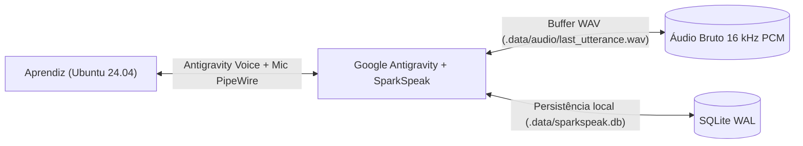
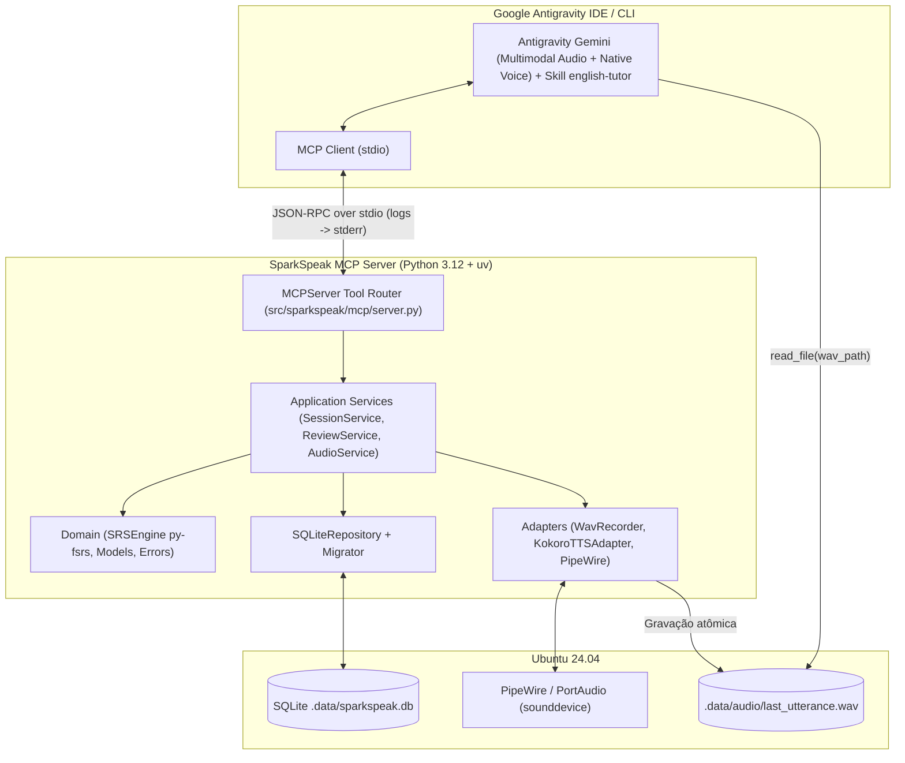

# Arquitetura e Diagramas C4

## 1. Diagrama de Contexto (C1)

## 2. Diagrama de Containers (C2)

## 3. Componentes e Camadas (C3)

- **Domain (`src/sparkspeak/domain/`)**: `srs_engine.py` (wrapper puro de `py-fsrs` com `desired_retention=0.90`), `models.py` (DTOs imutáveis) e `errors.py` (`ErrorCode`, `SparkSpeakError`).
- **Application (`src/sparkspeak/application/`)**: `review_service.py` (validação de limites, `get_due_cards`, `submit_review`, `add_card`), `session_service.py` (`start_session` com `mic_available`, `switch_input_mode`, `log_mistake`, `log_turn_and_errors`, `end_session` com promoção de erros) e `audio_service.py` (`asyncio.Lock` single-flight para `record_utterance`).
- **Infrastructure (`src/sparkspeak/infrastructure/`)**:
  - `db/`: `connection.py` (WAL, `foreign_keys=ON`, `busy_timeout=5000`), `migrator.py` (backup pré-migração + `001_initial.sql` + `001_default_decks.sql`) e `repositories.py`.
  - `audio/`: `ports.py` (`UtteranceRecorder`, `TTSEngine`, `RecordUtteranceResult`, `SpeakResult`), `pipewire_device.py`, `wav_recorder.py` (`WavRecorder` 16 kHz mono 16-bit PCM com endpointing RMS) e `kokoro_tts.py` (`KokoroTTSAdapter` offline com vozes `af_heart`, `af_jessica`, `am_liam`, `am_puck`).
- **MCP (`src/sparkspeak/mcp/`)**: `server.py` (entrypoint `sparkspeak-mcp`, expondo 9 tools enxutas).
