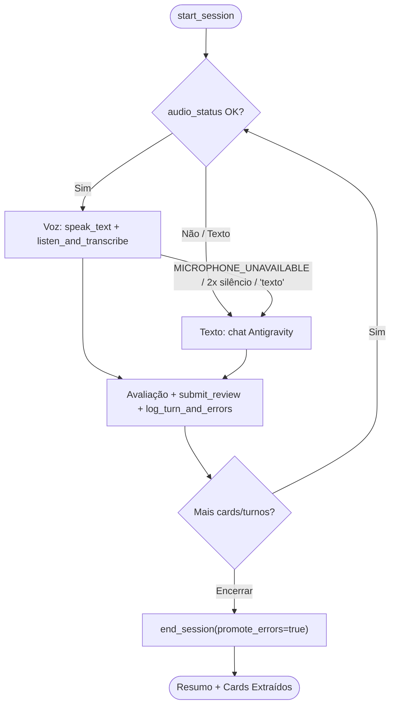
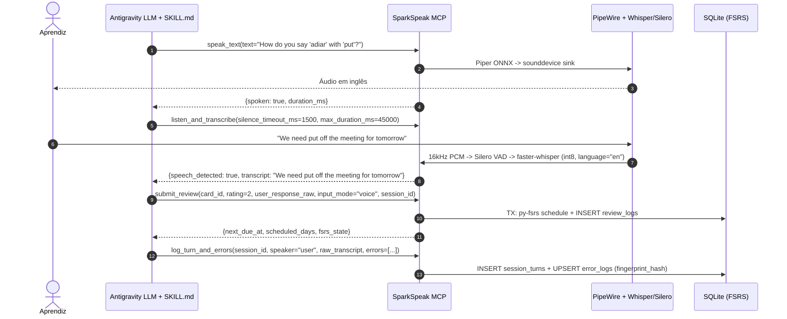
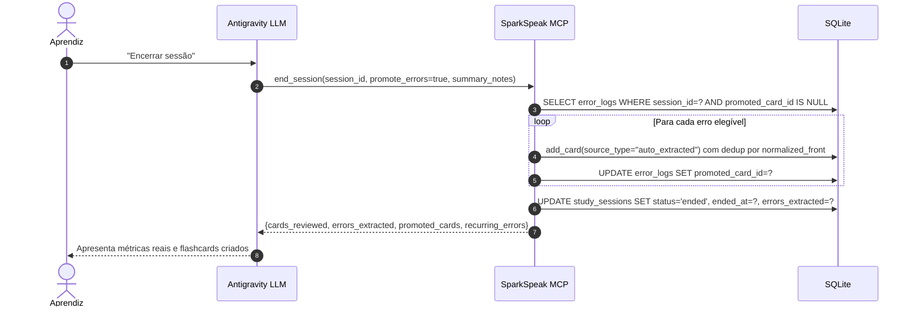

# Fluxos e Diagramas de Sequência

## 1. Fluxo Principal de Sessão e Fallback

## 2. Sequência: Captura VAD + Transcrição Verbatim + Review FSRS

## 3. Sequência: Encerramento e Promoção Automática de Cards

