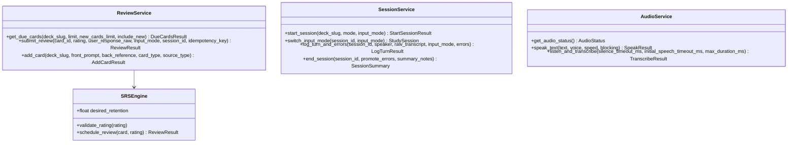
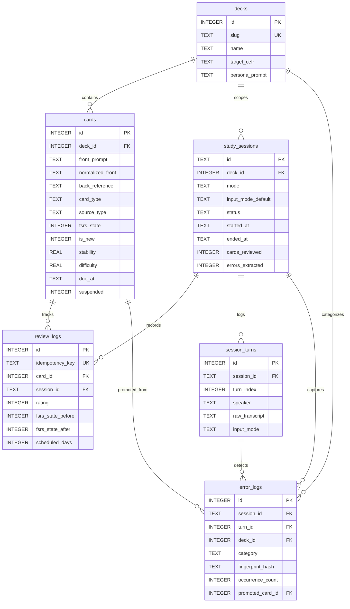
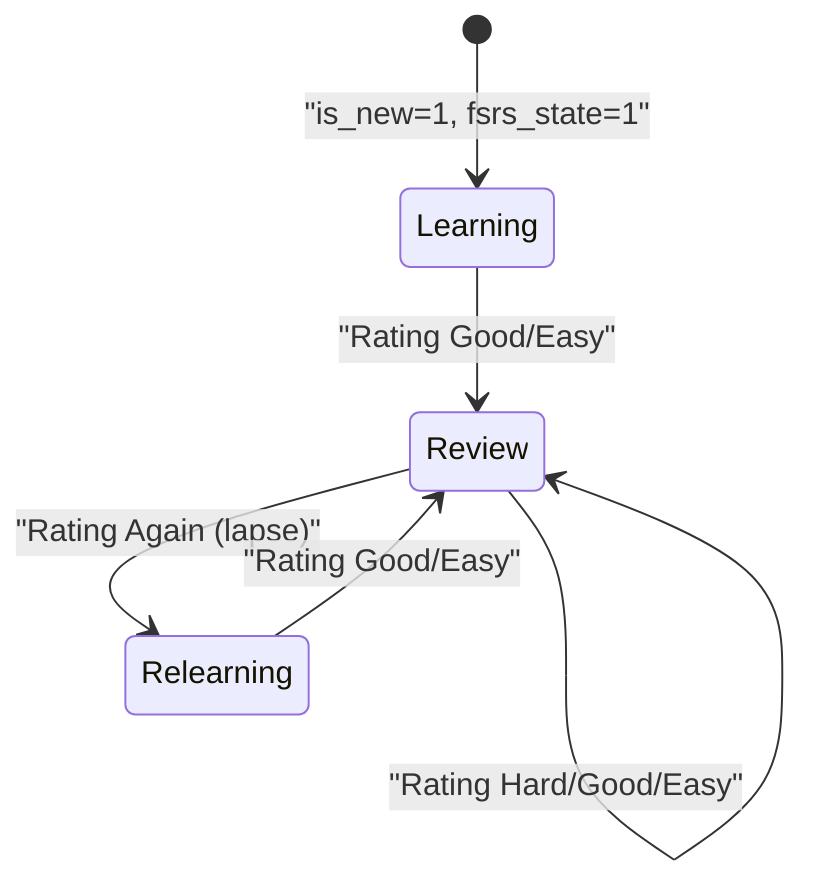

# Modelo de Domínio e Dados

## 1. Diagrama de Classes / Serviços

## 2. Modelo de Persistência (ER SQLite — `001_initial.sql`)

## 3. Índices e Constraints

- `UNIQUE (deck_id, normalized_front)` em `cards` (deduplicação em `add_card`).
- `UNIQUE (session_id, turn_index)` em `session_turns`.
- `UNIQUE (idempotency_key)` em `review_logs` (replay seguro de `submit_review`).
- `idx_cards_due_queue` em `cards(suspended, is_new, due_at, deck_id)`.
- `idx_review_logs_card_time` em `review_logs(card_id, reviewed_at DESC)` e `idx_review_logs_session` em `review_logs(session_id)`.
- `idx_error_logs_fingerprint` em `error_logs(fingerprint_hash)` e `idx_error_logs_session` em `error_logs(session_id, promoted_card_id)`.

## 4. Máquina de Estados

